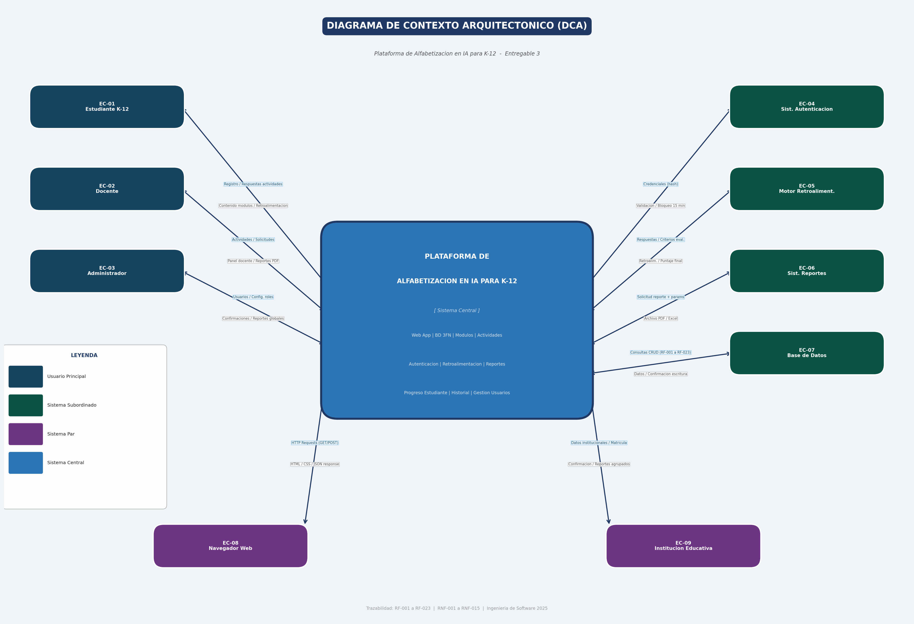

# E3 · Diagrama de Contexto Arquitectónico (DCA)

## Sistema Central

**PLATAFORMA DE ALFABETIZACIÓN EN IA PARA K-12**

Sistema web que centraliza la gestión de usuarios, módulos educativos de IA, actividades interactivas y seguimiento del progreso académico de estudiantes K-12.

## Diagrama

*Figura 1: DCA — 9 entidades externas y flujos de datos con el sistema central*

## Descripción de Flujos Principales

| Flujo | Origen → Destino | Datos |
|-------|-----------------|-------|
| F-01 | Estudiante → Sistema | Credenciales, respuestas a actividades |
| F-02 | Sistema → Estudiante | Módulos, retroalimentación, historial |
| F-03 | Docente → Sistema | Actividades nuevas, solicitudes de seguimiento |
| F-04 | Sistema → Docente | Panel de seguimiento, reportes descargables |
| F-05 | Administrador → Sistema | Gestión de usuarios, módulos y roles |
| F-06 | Sistema → Administrador | Confirmaciones, reportes globales |
| F-07 | Sistema → BD | Operaciones CRUD (lectura/escritura) |
| F-08 | BD → Sistema | Datos consultados, confirmaciones |
| F-09 | Sistema → Motor Retroalim. | Respuesta + criterio de evaluación |
| F-10 | Motor Retroalim. → Sistema | Puntaje + retroalimentación (< 1s) |
| F-11 | Sistema → Sist. Reportes | Parámetros del reporte + formato |
| F-12 | Sist. Reportes → S3 | Archivo PDF/Excel generado |
