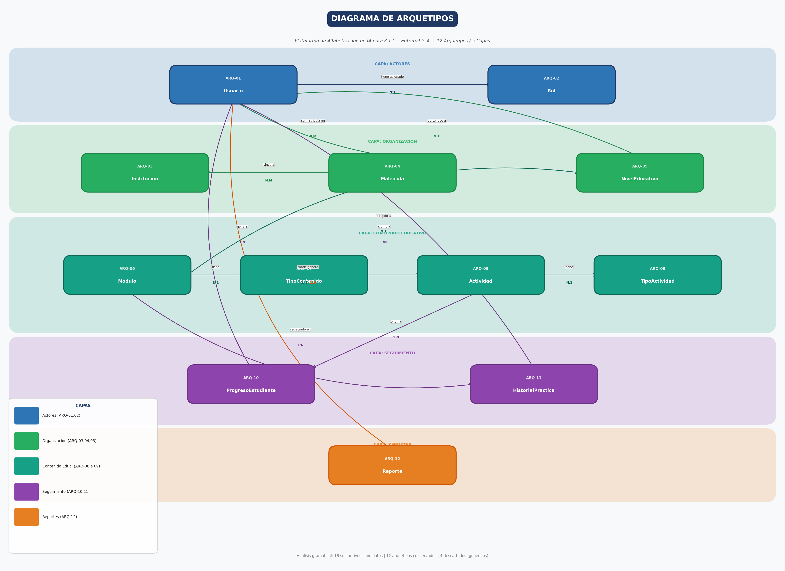

# E4 · Diagrama de Arquetipos

## Descripción
12 arquetipos identificados mediante análisis gramatical de los Casos de Uso y la ERS, organizados en 5 capas semánticas.

## Diagrama

*Figura 2: 12 arquetipos en 5 capas semánticas con 14 relaciones*

## Tabla de Arquetipos

| ID | Nombre | Capa | Descripción Semántica | Fuente ERS |
|----|--------|------|-----------------------|------------|
| ARQ-01 | Usuario | Actores | Actor central. Estudiante, Docente o Admin con identidad y credenciales | HU-001 a 018 / RF-001 a 006 |
| ARQ-02 | Rol | Actores | Define permisos y funciones del usuario en el sistema | RF-006 / HU-018 |
| ARQ-03 | Institución | Organización | Entidad educativa que agrupa usuarios y contextualiza reportes | MER / RF-001,002 |
| ARQ-04 | Matrícula | Organización | Vínculo N:M entre Usuario e Institución (entidad débil) | MER / RF-001 |
| ARQ-05 | NivelEducativo | Organización | Categoriza grados K-12 para filtrar contenido adecuado | MER / RF-007,008 |
| ARQ-06 | Módulo | Contenido Educativo | Unidad temática de aprendizaje con actividades agrupadas | HU-003,016 / RF-007 a 011 |
| ARQ-07 | TipoContenido | Contenido Educativo | Catálogo de categorías temáticas de módulos (3FN) | MER (3FN) / RF-007 |
| ARQ-08 | Actividad | Contenido Educativo | Ejercicio interactivo ejecutable que genera progreso y retroalimentación | HU-004,010 / RF-012 a 016 |
| ARQ-09 | TipoActividad | Contenido Educativo | Catálogo de tipos pedagógicos de actividades (3FN) | MER (3FN) / RF-012 |
| ARQ-10 | ProgresoEstudiante | Seguimiento | Registro de avance por actividad con guardado automático | HU-005,008 / RF-017,020 |
| ARQ-11 | HistorialPractica | Seguimiento | Registro histórico de módulos completados por estudiante | HU-005,006 / RF-018,019,021 |
| ARQ-12 | Reporte | Reportes | Documento de progreso exportable en PDF o Excel | HU-012,017 / RF-022,023 |

## Capas Semánticas

| Capa | Arquetipos | Descripción |
|------|-----------|-------------|
| Actores | ARQ-01, ARQ-02 | Personas y roles del sistema |
| Organización | ARQ-03, ARQ-04, ARQ-05 | Estructura institucional y clasificación |
| Contenido Educativo | ARQ-06, ARQ-07, ARQ-08, ARQ-09 | Material de aprendizaje y actividades |
| Seguimiento | ARQ-10, ARQ-11 | Registro del progreso académico |
| Reportes | ARQ-12 | Informes y exportaciones |
