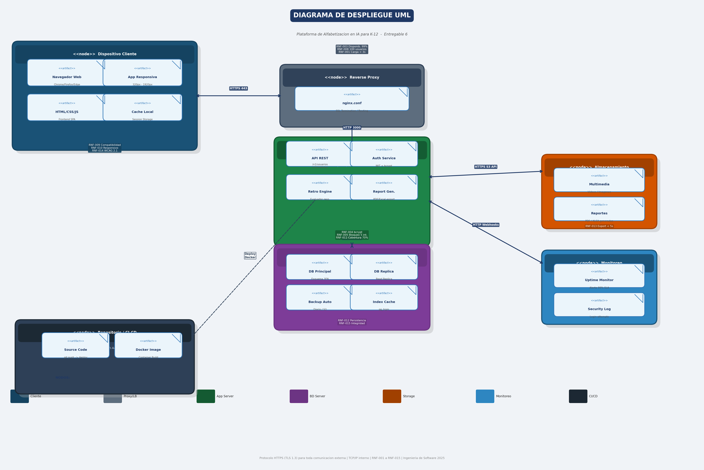

# E6 · Diagrama de Despliegue UML

## Descripción
7 nodos físicos con sus artefactos, protocolos de comunicación y justificación en RNF.

## Diagrama



*Figura 4: 7 nodos físicos con artefactos y protocolos de comunicación*

## Tabla de Nodos

| Nodo | Nombre | Tecnología / Artefactos | Protocolo | RNF Justifica |
|------|--------|------------------------|-----------|---------------|
| NOD-01 | Dispositivo Cliente | Navegador Chrome/Firefox/Edge, App Responsiva HTML/CSS/JS | HTTPS 443 | RNF-009,010,014 |
| NOD-02 | Reverse Proxy (Nginx) | nginx.conf, SSL/TLS 1.3, Reglas de enrutamiento | HTTPS 443 / HTTP 3000 | RNF-003,008 |
| NOD-03 | Servidor Aplicación (Node.js) | API REST, Auth JWT+bcrypt, Motor Retroalim., Generador PDF/Excel | HTTP 3000 / TCP 5432 | RNF-001,002,004,005,011 |
| NOD-04 | Servidor BD (PostgreSQL 15) | Esquema 3FN, Réplica de lectura, Backup diario, Índices | TCP 5432 | RNF-012,015 |
| NOD-05 | Almacenamiento S3 | Bucket multimedia, Bucket reportes generados PDF/Excel | HTTPS S3 API | RNF-013 |
| NOD-06 | Monitoreo (UptimeRobot) | Monitor 24/7, Log de seguridad, Alertas email/SMS | HTTP Webhooks | RNF-003,005 |
| NOD-07 | CI/CD (GitHub Actions) | Código fuente, Pipeline build, Imagen Docker, Deploy automático | SSH / GitHub API | RNF-011 |

## Flujo de Comunicación

```
Cliente (NOD-01)
    ↓ HTTPS 443
Nginx (NOD-02) ← UptimeRobot (NOD-06)
    ↓ HTTP 3000
Node.js (NOD-03)
    ↓ TCP 5432          ↓ HTTPS S3
PostgreSQL (NOD-04)   Storage S3 (NOD-05)

GitHub (NOD-07) → Deploy → Node.js (NOD-03)
```
