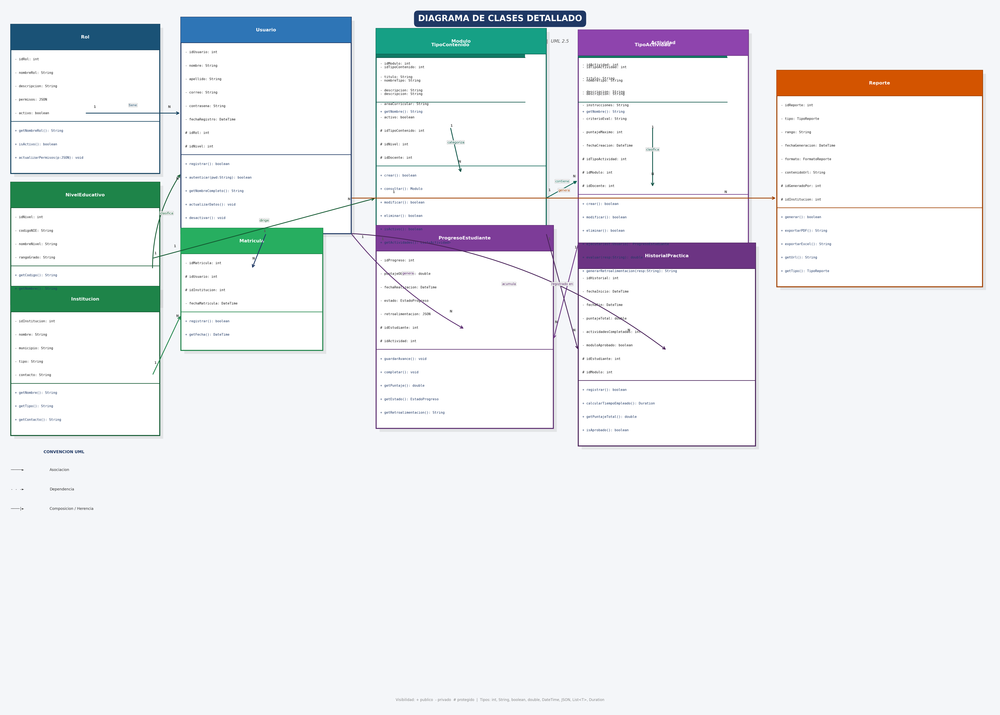

# E12 · Diagrama de Clases Detallado

## Diagrama

*Figura 5: 12 clases UML con atributos, métodos y relaciones*

## Clases del Sistema

| Clase | Capa | RF | Atributos | Métodos Clave | Relaciones UML |
|-------|------|----|-----------|---------------|----------------|
| Usuario | Actores | RF-001 a 006 | +id_usuario: int, +nombre: String, +apellido: String, +correo: String, -contrasena: String, +fechaRegistro: Date | +registrar(), +autenticar(pwd): bool, +getNombreCompleto(): String, +desactivar() | N:1 Rol · N:1 NivelEducativo · 1:N ProgresoEstudiante · 1:N HistorialPractica · 1:N Reporte |
| Rol | Actores | RF-006 | +id_rol: int, +nombreRol: String, +permisos: JSON, +activo: bool | +getNombreRol(): String, +isActivo(): bool, +actualizarPermisos() | 1:N Usuario |
| NivelEducativo | Organización | RF-007,008 | +id_nivel: int, +codigoNIE: String, +nombreNivel: String, +rangoGrado: String | +getCodigo(): String, +getNombre(): String | 1:N Usuario · 1:N Modulo |
| Institucion | Organización | RF-001,002 | +id_institucion: int, +nombre: String, +municipio: String, +tipo: String | +getNombre(): String | N:M Usuario (vía Matricula) |
| Matricula | Organización | RF-001 | +id_matricula: int, +fechaMatricula: Date | +registrar() | N:1 Usuario · N:1 Institucion |
| Modulo | Contenido Educ. | RF-007 a 011 | +id_modulo: int, +titulo: String, +descripcion: String, +activo: bool | +crear(), +consultar(), +modificar(), +eliminar(), +getActividades(): List | Composición 1:N Actividad · N:1 TipoContenido · N:1 NivelEducativo |
| TipoContenido | Contenido Educ. | RF-007 | +id_tipo: int, +nombreTipo: String | +getNombreTipo(): String | 1:N Modulo |
| Actividad | Contenido Educ. | RF-012 a 016 | +id_actividad: int, +titulo: String, +instrucciones: String, +puntajeMaximo: int | +crear(), +ejecutar(est): void, +evaluar(resp): Puntaje, +generarRetroalimentacion() | N:1 TipoActividad · N:1 Modulo · 1:N ProgresoEstudiante |
| TipoActividad | Contenido Educ. | RF-012 | +id_tipo: int, +nombreTipo: String | +getNombreTipo(): String | 1:N Actividad |
| ProgresoEstudiante | Seguimiento | RF-017,020 | +id_progreso: int, +puntajeObtenido: float, +fechaRealizacion: Date, +estado: String | +guardarAvance(), +completar(), +getPuntaje(): float, +getEstado(): String | N:1 Usuario · N:1 Actividad |
| HistorialPractica | Seguimiento | RF-018,019,021 | +id_historial: int, +fechaInicio: Date, +fechaFin: Date, +puntajeTotal: float, +moduloAprobado: bool | +registrar(), +calcularTiempoEmpleado(): Duration, +isAprobado(): bool | N:1 Usuario · N:1 Modulo |
| Reporte | Reportes | RF-022,023 | +id_reporte: int, +tipo: String, +formato: String, +contenidoUrl: String | +generar(), +exportarPDF(), +exportarExcel(), +getUrl(): String | N:1 Usuario (generador) |

## Visibilidad de Atributos
- `+` Público — accesible desde cualquier clase
- `-` Privado — solo accesible dentro de la clase
- `#` Protegido — accesible desde la clase y sus subclases

## Tipos de Relaciones
- **Asociación (→):** relación de uso entre clases
- **Composición (◆→):** la clase hijo no puede existir sin el padre (Modulo ◆→ Actividad)
- **Agregación (◇→):** la clase hijo puede existir independientemente
