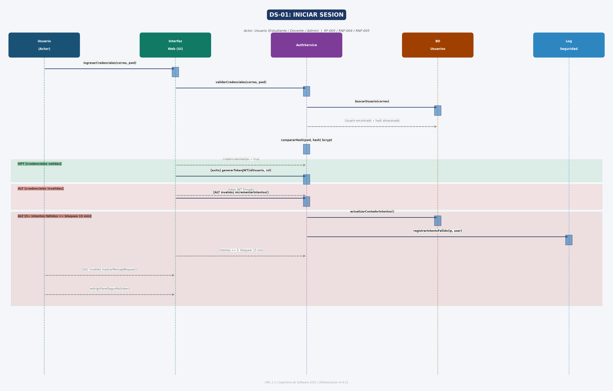
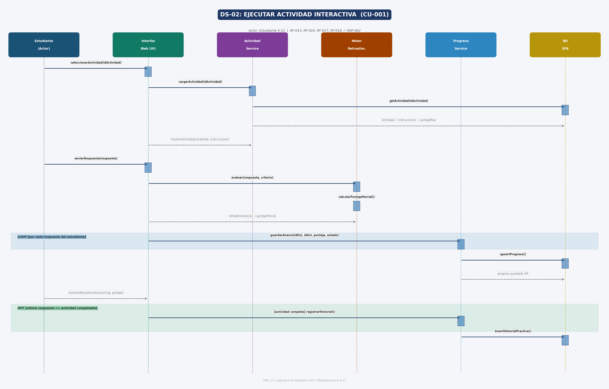
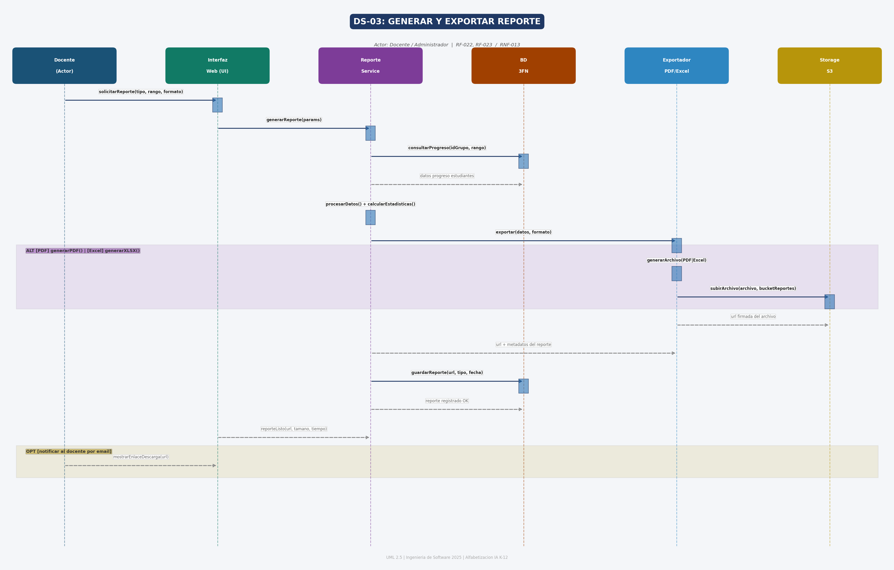

# E13 · Diagramas de Secuencia

## DS-01: Iniciar Sesión

**RF cubiertos:** RF-005 / RNF-004, RNF-005  
**Actores:** Usuario → Interfaz Web → AuthService → BD Usuarios → Log Seguridad

*Figura 6: DS-01 — Flujo de autenticación con bloqueo por intentos*

### Flujo Normal
1. Usuario ingresa correo y contraseña en el formulario de login
2. Interfaz Web envía credenciales a AuthService
3. AuthService busca al usuario en BD por correo
4. AuthService compara la contraseña con el hash bcrypt almacenado (RNF-004)
5. Si es válido: AuthService genera token JWT y retorna al cliente
6. Interfaz Web redirige al panel correspondiente según el rol del usuario

### Flujo Alternativo A1 — Credenciales inválidas
- AuthService incrementa el contador de intentos fallidos del usuario
- Muestra mensaje de error en el formulario

### Flujo Alternativo A2 — 5 intentos fallidos consecutivos
- AuthService bloquea la cuenta por 15 minutos (RNF-005)
- Registra el evento en el Log de Seguridad
- Muestra mensaje de bloqueo con tiempo restante

---

## DS-02: Ejecutar Actividad Interactiva (CU-001)

**RF cubiertos:** RF-013, RF-016, RF-017, RF-018 / RNF-002, RNF-012  
**Actores:** Estudiante → UI → ActividadService → Motor Retroalim. → ProgresoService → BD 3FN

*Figura 7: DS-02 — Flujo completo de ejecución de actividad con flujos alternativos*

### Flujo Normal
1. Estudiante selecciona una actividad del catálogo
2. UI solicita la carga de la actividad a ActividadService
3. ActividadService consulta la actividad en BD y la retorna con instrucciones
4. UI muestra la actividad al estudiante con contenido multimedia
5. Estudiante envía una respuesta
6. UI pasa la respuesta al Motor de Retroalimentación junto al criterio de evaluación
7. Motor evalúa y retorna puntaje + retroalimentación en **< 1 segundo** (RNF-002)
8. ProgresoService guarda el avance automáticamente en BD (RNF-012)
9. Al completar todas las preguntas: ProgresoService registra en HISTORIAL_PRACTICA (RF-018)

### Flujo Alternativo A1 — Sesión expirada (> 30 min)
- Sistema guarda el progreso parcial automáticamente
- Redirige al login. Al reingresar el estudiante retoma desde el último punto

### Flujo Alternativo A2 — Respuesta incorrecta
- Motor genera retroalimentación explicando el concepto correcto
- Permite reintentar (máximo 3 veces por pregunta)

---

## DS-03: Generar y Exportar Reporte (CU-005)

**RF cubiertos:** RF-022, RF-023 / RNF-013  
**Actores:** Docente/Admin → UI → ReporteService → BD 3FN → Exportador → Storage S3

*Figura 8: DS-03 — Generación y exportación de reporte con variantes PDF/Excel*

### Flujo Normal
1. Docente configura parámetros del reporte (tipo, rango, grupo, formato)
2. ReporteService consulta PROGRESO_ESTUDIANTE, HISTORIAL_PRACTICA y USUARIO en BD
3. ReporteService procesa datos: calcula promedios, porcentajes y estadísticas del grupo
4. Exportador genera el archivo en el formato seleccionado (PDF o Excel)
5. Sistema sube el archivo al bucket S3 y obtiene URL firmada
6. ReporteService registra el reporte en la tabla REPORTE con metadatos y URL
7. UI muestra toast de notificación con enlace de descarga directa

### Flujo Alternativo A1 — Formato PDF
- Exportador aplica plantilla institucional con logo, encabezado y tabla de datos
- Tiempo de generación < 5 segundos para grupos de hasta 50 estudiantes (RNF-013)

### Flujo Alternativo A2 — Formato Excel
- Exportador genera XLSX con: hoja de datos por estudiante + hoja de resumen estadístico + gráfica de barras

### Flujo Alternativo A3 — Grupo supera 50 estudiantes
- Sistema notifica que el reporte se generará en segundo plano
- Procesa en lotes de 50 de forma asíncrona
- Notifica al usuario cuando el reporte completo esté disponible
