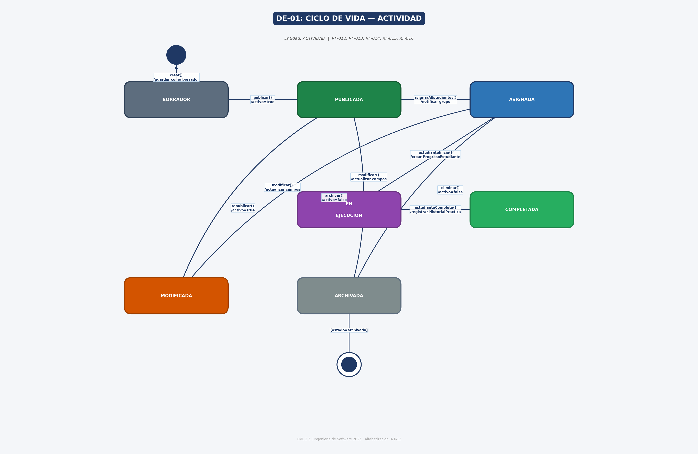
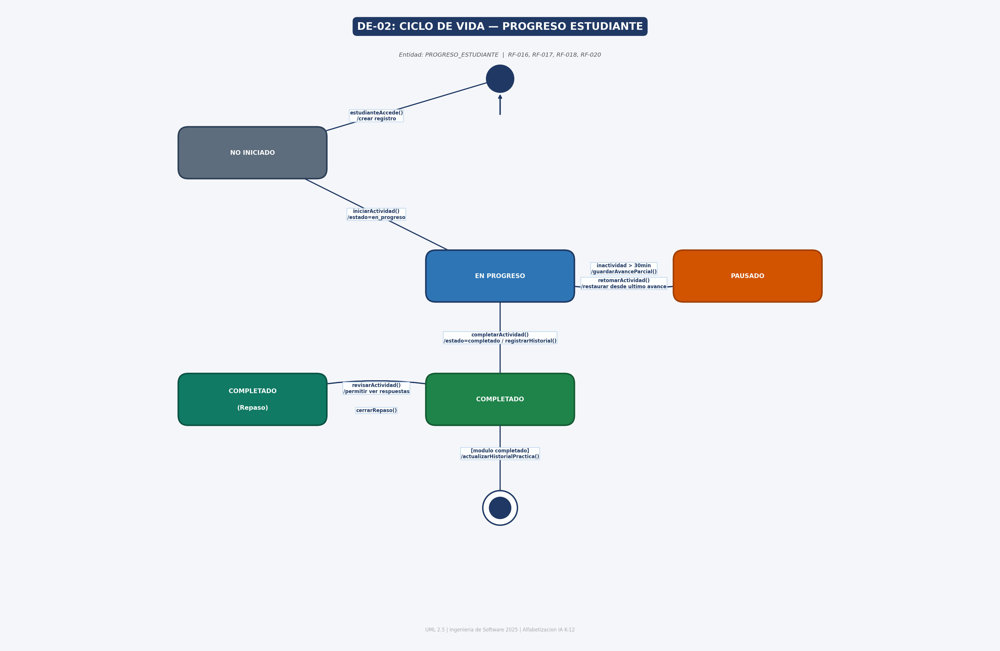
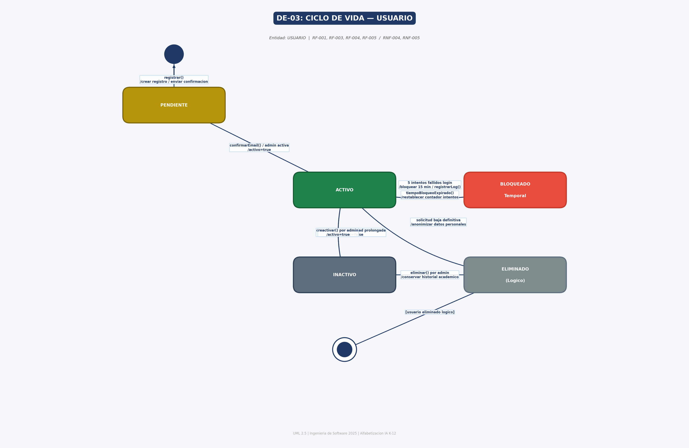

# E14 · Diagrama de Estados

## DE-01: Ciclo de Vida — ACTIVIDAD

**RF cubiertos:** RF-012, RF-013, RF-014, RF-015, RF-016

*Figura 9: DE-01 — Ciclo de vida de ACTIVIDAD (7 estados, 9 transiciones)*

| Estado | Descripción | Transición Entrada | Transición Salida |
|--------|-------------|-------------------|------------------|
| BORRADOR | Actividad en creación, no visible | crear() | publicar() |
| PUBLICADA | Visible en catálogo del nivel | publicar() | asignar() · modificar() · archivar() |
| MODIFICADA | En edición por el docente | modificar() | publicar() |
| ASIGNADA | Asignada a un grupo específico | asignar() | estudianteInicia() · cancelarAsignación() |
| EN EJECUCIÓN | Un estudiante la está realizando | estudianteInicia() | estudianteCompleta() · sessionExpira() |
| COMPLETADA | El estudiante la finalizó | estudianteCompleta() | revisarActividad() |
| ARCHIVADA | Desactivada. activo=false. Conserva historial | archivar() | — |

---

## DE-02: Ciclo de Vida — PROGRESO_ESTUDIANTE

**RF cubiertos:** RF-016, RF-017, RF-018, RF-020 / CU-001

*Figura 10: DE-02 — Ciclo de vida de PROGRESO_ESTUDIANTE con guardado automático*

| Estado | Descripción | Transición Entrada | Transición Salida |
|--------|-------------|-------------------|------------------|
| NO INICIADO | El estudiante no ha empezado la actividad | — | iniciarActividad() |
| EN PROGRESO | Actividad en curso. Guardado automático activo | iniciarActividad() | completar() · sessionExpira() |
| PAUSADO | Sesión expirada. Progreso parcial guardado | sessionExpira() | retomar() |
| COMPLETADO | Actividad finalizada. Puntaje registrado | completar() | revisarActividad() |
| REPASO | Solo lectura. Muestra respuestas y retroalimentación | revisarActividad() | — |

**Regla clave:** El sistema guarda automáticamente el avance sin acción del estudiante (RNF-012).

---

## DE-03: Ciclo de Vida — USUARIO

**RF cubiertos:** RF-001, RF-003, RF-004, RF-005 / RNF-004, RNF-005

*Figura 11: DE-03 — Ciclo de vida de USUARIO con bloqueo de seguridad*

| Estado | Descripción | Transición Entrada | Transición Salida |
|--------|-------------|-------------------|------------------|
| PENDIENTE | Registro creado, pendiente de activación | registrar() | activar() |
| ACTIVO | Usuario con acceso normal al sistema | activar() | loginFallido5x() · desactivar() |
| BLOQUEADO_TEMPORAL | Bloqueado 15 min tras 5 intentos fallidos | loginFallido5x() | timerExpira() · adminDesbloquea() |
| INACTIVO | Desactivado por admin. Conserva historial | desactivar() | reactivar() · eliminarLogico() |
| ELIMINADO_LOGICO | Datos anonimizados. Historial académico conservado | eliminarLogico() | — |

**Regla clave:** El historial académico NUNCA se borra al desactivar o eliminar lógicamente un usuario.
