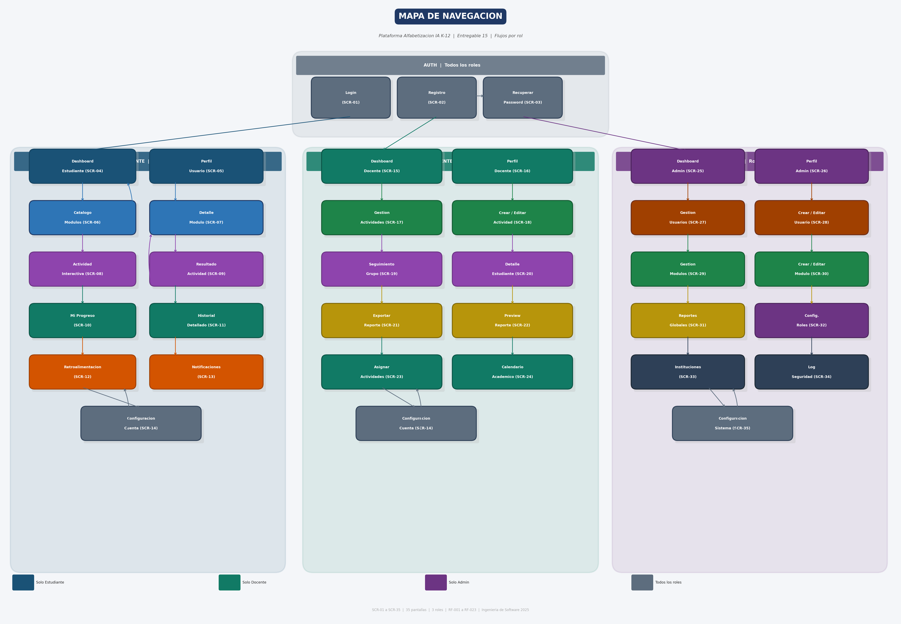

# E15 · Mapa de Navegación

## Descripción
35 pantallas organizadas en 5 módulos con roles de acceso, flujos de navegación y trazabilidad RF.

## Diagrama

*Figura 12: 35 pantallas (SCR-01 a SCR-35), 3 roles, flujos completos*

## Módulos de Navegación

### Autenticación (SCR-01 a SCR-03) — Todos los roles
| SCR | Nombre | Acceso | Flujo siguiente |
|-----|--------|--------|-----------------|
| SCR-01 | Login | Todos | → Panel según rol (SCR-04/15/25) |
| SCR-02 | Registro | Público | → SCR-01 Login |
| SCR-03 | Recuperar Password | Todos | → SCR-01 Login |

### Panel Estudiante (SCR-04 a SCR-13) — Rol: Estudiante K-12
| SCR | Nombre | Flujo principal |
|-----|--------|----------------|
| SCR-04 | Dashboard Estudiante | → SCR-06 Catálogo Módulos |
| SCR-05 | Mi Perfil | → SCR-14 Config. Cuenta |
| SCR-06 | Catálogo Módulos | → SCR-07 Detalle Módulo |
| SCR-07 | Detalle Módulo | → SCR-08 Actividad Interactiva |
| SCR-08 | Actividad Interactiva | → SCR-09 Resultado Actividad |
| SCR-09 | Resultado Actividad | → SCR-10 Mi Progreso |
| SCR-10 | Mi Progreso | → SCR-11 Historial Completo |
| SCR-11 | Historial Completo | → SCR-12 Retroalimentación |
| SCR-12 | Retroalimentación | ← desde SCR-08/09 |
| SCR-13 | Notificaciones | ← desde Dashboard |

### Panel Docente (SCR-15 a SCR-24) — Rol: Docente
| SCR | Nombre | Flujo principal |
|-----|--------|----------------|
| SCR-15 | Dashboard Docente | → SCR-17 Gestión Actividades |
| SCR-16 | Mi Perfil Docente | → SCR-14 Config. Cuenta |
| SCR-17 | Gestión Actividades | → SCR-18 Crear/Editar Actividad |
| SCR-18 | Crear/Editar Actividad | ← desde SCR-17 |
| SCR-19 | Seguimiento Grupo | → SCR-20 Detalle Estudiante |
| SCR-20 | Detalle Estudiante | → SCR-21 Exportar Reporte |
| SCR-21 | Exportar Reporte | → SCR-22 Preview Reporte |
| SCR-22 | Preview / Descarga Reporte | Descarga PDF/Excel |
| SCR-23 | Asignar Actividades | ← desde SCR-17 |
| SCR-24 | Calendario Académico | ← desde Dashboard |

### Panel Administrador (SCR-25 a SCR-35) — Rol: Administrador
| SCR | Nombre | Flujo principal |
|-----|--------|----------------|
| SCR-25 | Dashboard Admin | → SCR-27 Gestión Usuarios |
| SCR-26 | Mi Perfil Admin | → SCR-14 Config. Cuenta |
| SCR-27 | Gestión Usuarios | → SCR-28 Crear/Editar Usuario |
| SCR-28 | Crear/Editar Usuario | ← desde SCR-27 |
| SCR-29 | Gestión Módulos | → SCR-30 Crear/Editar Módulo |
| SCR-30 | Crear/Editar Módulo | ← desde SCR-29 |
| SCR-31 | Reportes Globales | → Descarga PDF/Excel |
| SCR-32 | Config. Roles | ← desde Dashboard |
| SCR-33 | Gestión Instituciones | ← desde Dashboard |
| SCR-34 | Log de Seguridad | ← desde Dashboard |
| SCR-35 | Config. Sistema | ← desde Dashboard |

### Compartida — Todos los roles
| SCR | Nombre | Acceso |
|-----|--------|--------|
| SCR-14 | Configuración de Cuenta | Todos los roles |
