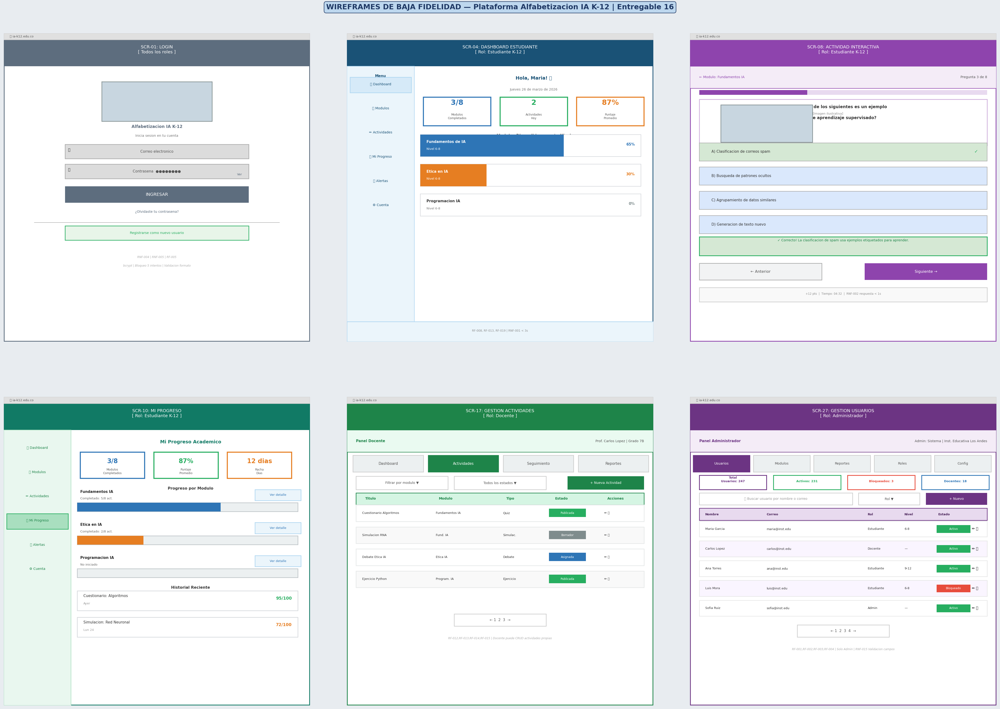

# E16 · Wireframes de Baja Fidelidad

## Descripción
6 pantallas estructurales sin colores ni estilos definitivos. Solo estructura: regiones, elementos y acciones disponibles.

## Diagrama

*Figura 13: 6 pantallas principales en escala de grises*

---

## SCR-01 · Login
**Rol:** Todos

**Regiones:**
- Header: Logo de la plataforma
- Formulario central: campo correo + campo contraseña + checkbox "recordarme"
- CTA principal: botón "Ingresar"
- Opciones secundarias: enlace "¿Olvidaste tu contraseña?" + enlace "Registrarse"
- Nota de seguridad: texto pequeño sobre el cifrado

**Acciones:**
- Ingresar → redirige al panel según rol
- Recuperar contraseña → SCR-03
- Registrarse → SCR-02
- 5 intentos fallidos → bloqueo 15 min (RNF-005)

---

## SCR-04 · Dashboard Estudiante
**Rol:** Estudiante K-12

**Regiones:**
- Sidebar izquierda: menú de navegación con íconos y etiquetas
- Header: saludo personalizado + fecha + notificaciones
- Sección principal: 3 cards de resumen (módulos en progreso, actividades completadas, puntaje promedio)
- Lista de módulos en progreso con barra de porcentaje
- Panel de acciones rápidas

**Acciones:**
- Clic en módulo → SCR-07 Detalle Módulo
- Clic en "Mi Progreso" → SCR-10
- Clic en notificación → SCR-13

---

## SCR-08 · Actividad Interactiva
**Rol:** Estudiante K-12

**Regiones:**
- Breadcrumb: Módulo → Actividad (con barra de progreso general)
- Header actividad: título + cronómetro + número de pregunta
- Tarjeta de pregunta: enunciado + imagen/diagrama (si aplica)
- Zona de opciones: 4 opciones de respuesta (radio buttons)
- Zona de retroalimentación: aparece al responder (< 1s)
- Navegación: botones anterior/siguiente + estado general de preguntas

**Acciones:**
- Clic en opción → evaluación en < 1s + guardado automático (RNF-002, RNF-012)
- Siguiente → guarda avance y avanza a siguiente pregunta
- Finalizar → modal de confirmación → SCR-09 Resultado

---

## SCR-10 · Mi Progreso
**Rol:** Estudiante K-12

**Regiones:**
- Sidebar: navegación lateral
- Header: título + resumen global (3 cards: completados, en progreso, promedio)
- Indicadores circulares por módulo (porcentaje de completitud)
- Historial reciente: tabla con últimas actividades, puntajes y fechas
- Botón: "Exportar mi progreso en PDF"

**Acciones:**
- Clic en módulo → SCR-07 Detalle Módulo
- Ver historial completo → SCR-11
- Exportar → descarga PDF personal

---

## SCR-17 · Gestión Actividades (Docente)
**Rol:** Docente

**Regiones:**
- Header panel + tabs: Mis Actividades | Seguimiento | Calendario
- Mini-cards resumen: total actividades, activas, completadas por estudiantes, promedio puntaje
- Barra de búsqueda + filtros: por módulo, tipo, estado
- Tabla de actividades: título, módulo, tipo, estado (badge), acciones (editar, eliminar, asignar)
- Paginación

**Acciones:**
- Nueva actividad → SCR-18 (modal)
- Editar → SCR-18 pre-cargada
- Eliminar → modal de confirmación
- Tab Seguimiento → SCR-19

---

## SCR-27 · Gestión Usuarios (Administrador)
**Rol:** Administrador

**Regiones:**
- Header admin + tabs: Usuarios | Roles | Log Seguridad
- 4 cards métricas: total usuarios, estudiantes, docentes, bloqueados
- Barra de búsqueda + filtro por rol
- Tabla de usuarios: nombre, correo, rol (badge de color), estado (badge), acciones
- Paginación

**Acciones:**
- Nuevo usuario → SCR-28
- Editar → SCR-28 pre-cargada
- Desactivar → conserva historial académico
- Tab Log Seguridad → SCR-34
