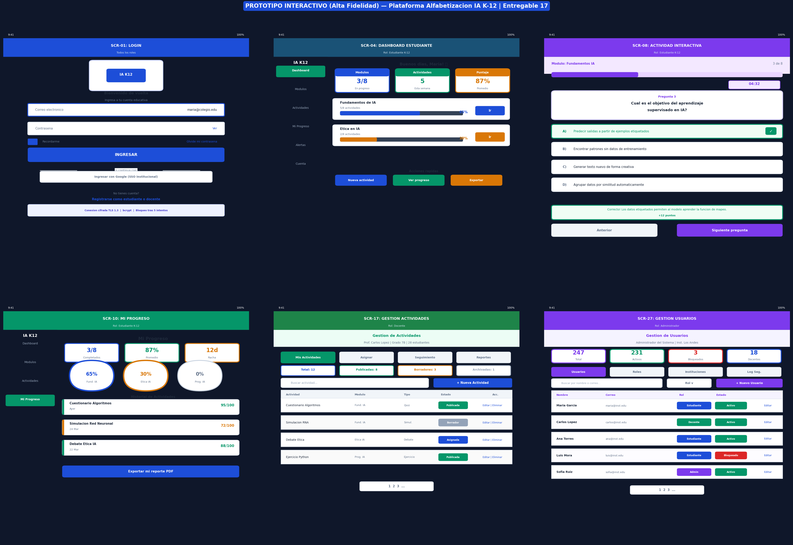

# E17 · Prototipo Interactivo (Alta Fidelidad)

## Diagrama

*Figura 14: 6 pantallas con identidad visual completa*

---

## Paleta de Colores

| Token | Nombre | Hex | RGB | Uso Principal |
|-------|--------|-----|-----|---------------|
| `primary` | Azul Institucional | `#1D4ED8` | rgb(29,78,216) | Botones CTA, enlaces activos, elementos principales |
| `secondary` | Violeta Educativo | `#7C3AED` | rgb(124,58,237) | Actividades interactivas, estados de ejecución |
| `success` | Verde Logro | `#059669` | rgb(5,150,105) | Respuestas correctas, estados completados |
| `warning` | Ámbar Progreso | `#D97706` | rgb(217,119,6) | Actividades en progreso, alertas moderadas |
| `danger` | Rojo Alerta | `#DC2626` | rgb(220,38,38) | Errores, bloqueados, intentos fallidos |
| `bg-dark` | Fondo Sidebar | `#0F172A` | rgb(15,23,42) | Sidebar de navegación, barras del sistema |
| `bg-light` | Fondo Principal | `#F8FAFC` | rgb(248,250,252) | Fondo general de pantallas de contenido |
| `text-main` | Texto Principal | `#1E293B` | rgb(30,41,59) | Títulos, etiquetas, contenido principal |
| `text-gray` | Texto Secundario | `#64748B` | rgb(100,116,139) | Subtítulos, placeholders, metadatos |
| `border` | Bordes | `#E2E8F0` | rgb(226,232,240) | Bordes de cards, inputs, separadores |

---

## Tipografía

| Fuente | Uso | Fallback |
|--------|-----|---------|
| **Inter** (Google Fonts) | Texto general, UI, botones, labels | system-ui, -apple-system, sans-serif |
| **JetBrains Mono** | Valores numéricos, puntajes, datos técnicos en tablas | 'Courier New', monospace |

---

## Interacciones Simuladas

| Pantalla | Interacción | Comportamiento |
|----------|-------------|----------------|
| SCR-01 Login | Clic INGRESAR | Spinner 300ms → fade-in al panel según rol |
| SCR-01 Login | 5 intentos fallidos | Formulario deshabilitado → contador regresivo 15 min (RNF-005) |
| SCR-04 Dashboard | Hover en card módulo | Elevación de sombra + tooltip con % exacto de progreso |
| SCR-08 Actividad | Clic en opción de respuesta | Resaltado < 100ms → evaluación → retroalimentación < 1s (RNF-002) |
| SCR-08 Actividad | Clic Siguiente | Slide-left → barra progreso actualizada → puntaje en tiempo real |
| SCR-08 Actividad | Finalizar actividad | Modal confirmación → animación resultado → SCR-09 |
| SCR-19 Seguimiento | Tabla de estudiantes | Actualización cada 30s vía polling o WebSocket |
| SCR-21 Exportar | Clic Exportar | Barra de progreso → descarga automática → toast (RNF-013) |
| Todas | Navegación sidebar | Fade-in 200ms. Ítem activo resaltado. Colapsa en < 768px |

---

## Flujos de Navegación del Prototipo

| ID | Flujo | Ruta | Animación |
|----|-------|------|-----------|
| F-01 | Login → Panel | SCR-01 → SCR-04/15/25 (según rol) | Fade-in + slide-up |
| F-02 | Explorar módulo | SCR-04 → SCR-06 → SCR-07 | Slide-right |
| F-03 | Ejecutar actividad | SCR-07 → SCR-08 → SCR-09 | Slide-left por pregunta |
| F-04 | Ver mi progreso | SCR-04 → SCR-10 → SCR-11 | Fade-in |
| F-05 | Crear actividad | SCR-15 → SCR-17 → SCR-18 | Modal slide-up |
| F-06 | Exportar reporte | SCR-19 → SCR-21 → SCR-22 | Modal overlay |
| F-07 | Gestionar usuarios | SCR-25 → SCR-27 → SCR-28 | Slide-up modal |
| F-08 | Gestionar módulos | SCR-25 → SCR-29 → SCR-30 | Slide-up modal |
| F-09 | Ver log seguridad | SCR-25 → SCR-34 | Fade-in |
| F-10 | Configurar roles | SCR-25 → SCR-32 | Fade-in |
| F-11 | Cierre de sesión | Cualquier pantalla → SCR-01 | Fade-out + clear session |
